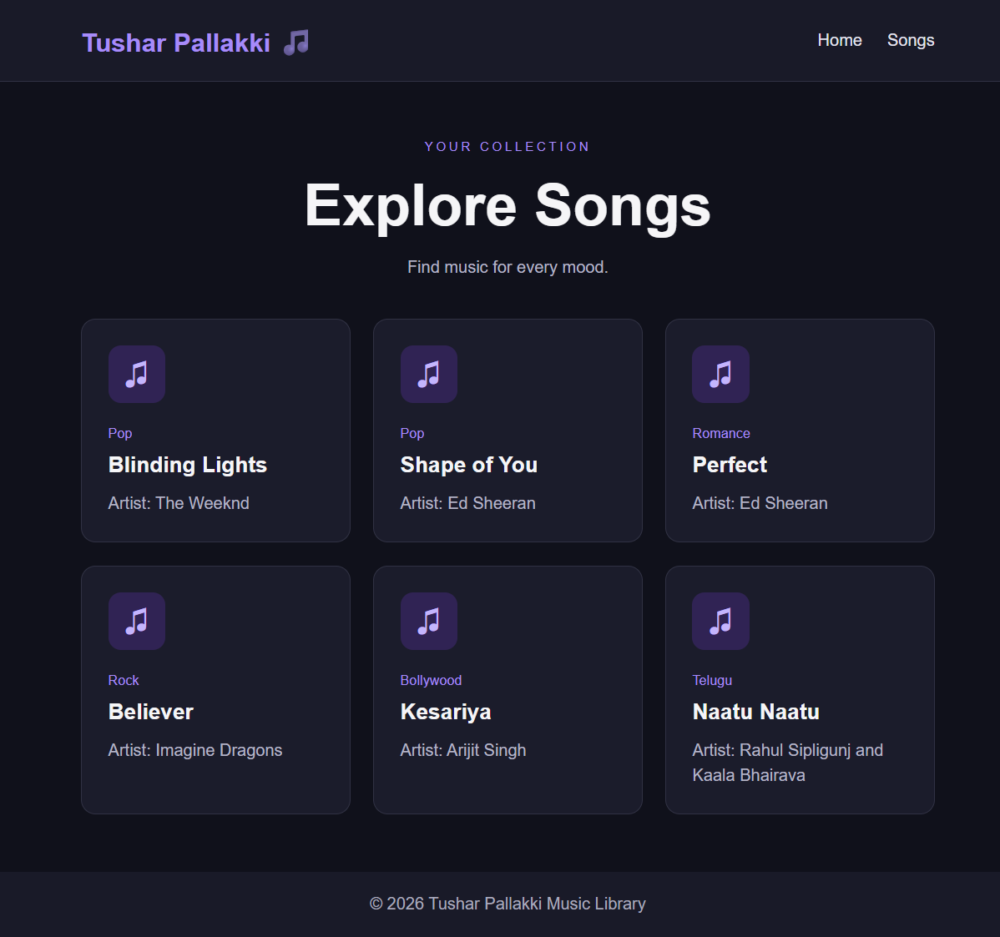

# 🎵 Tushar Music Library

A dynamic and personalized music library web application built using Node.js, Express.js, EJS, HTML and CSS.

Explore songs from different artists and genres through a simple and user-friendly interface.

## 🚀 Features

- Personalized homepage with Tushar Pallakki branding.
- Dynamic song listing.
- Displays song titles, artists and genres.
- Separate Home and Songs pages.
- Responsive and clean user interface.
- EJS template rendering.
- Static CSS styling.

## 🛠️ Technologies Used

- HTML5
- CSS3
- JavaScript
- Node.js
- Express.js
- EJS

## 📂 Project Structure

```text
tushar-music-library/
│
├── public/
│   └── style.css
│
├── views/
│   ├── index.ejs
│   └── songs.ejs
│
├── screenshots/
│   ├── home page.png
│   └── playlist.png
│
├── app.js
├── package.json
├── package-lock.json
├── .gitignore
└── README.md
```

## 🎶 Songs Collection

The application currently includes:

- Blinding Lights – The Weeknd
- Shape of You – Ed Sheeran
- Perfect – Ed Sheeran
- Believer – Imagine Dragons
- Kesariya – Arijit Singh
- Naatu Naatu – Rahul Sipligunj and Kaala Bhairava

## ⚙️ Installation and Setup

**Step 1: Clone the repository**

```bash
git clone https://github.com/tusharpallakki12/tushar-music-library.git
```

**Step 2: Open the project folder**

```bash
cd tushar-music-library
```

**Step 3: Install dependencies**

```bash
npm install
```

**Step 4: Start the application**

```bash
node app.js
```

**Step 5: Open in your browser**

http://localhost:3000

## 📸 Screenshots

### Home Page


### Playlist



## 👨‍💻 Developer

**Tushar Pallakki**

GitHub: https://github.com/tusharpallakki12

## 📄 License

This project is created for educational and learning purposes.

---

⭐ If you like this project, consider giving it a star on GitHub!
